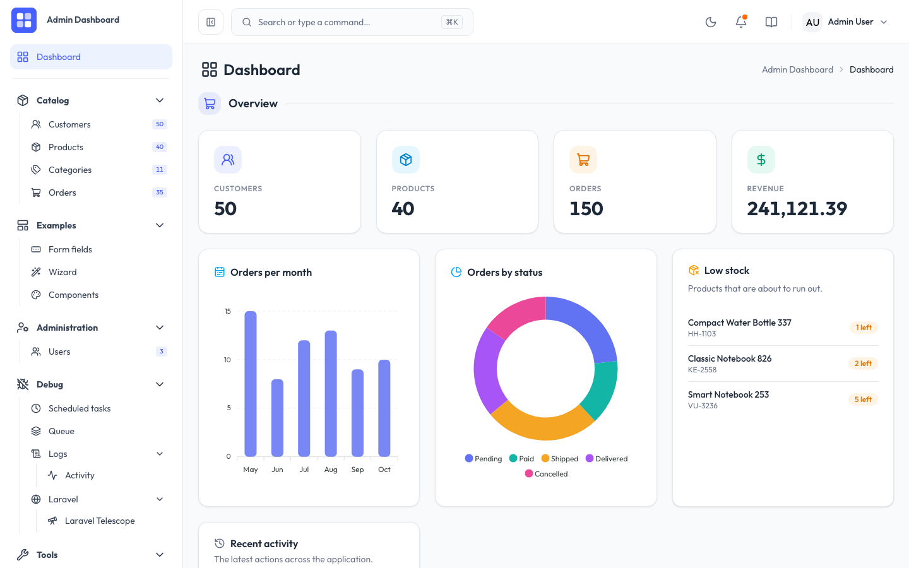
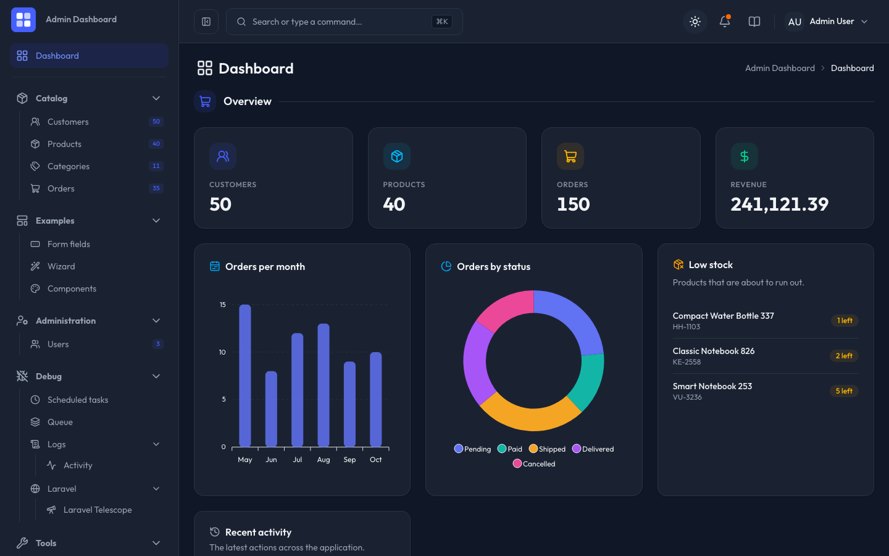

<div align="center">

# 🧩 Laravel Admin Dashboard Template

**A batteries-included admin backend: generic CRUD engine, rich tables, auth with 2FA and passkeys, and example pages for every common pattern.**

<code>Laravel 13</code> &nbsp;→&nbsp; <code>Inertia 3</code> &nbsp;→&nbsp; <code>Vue 3 + Tailwind 4</code>


</div>

---

## ✨ Why this template

Most admin templates are a pile of static screens. This one is built around a **generic CRUD engine**: a section is a thin controller plus a Vue page that only *declares* its columns and form fields. Search, sorting, pagination, bulk actions, soft deletes, drag-and-drop ordering, tree views and file uploads come for free.

| | Feature |
|---|---|
| 🗂️ | Generic `ResourceController` + `ResourceIndex.vue` CRUD engine |
| 📊 | Dashboard with KPI cards, ApexCharts and an activity timeline |
| 🔐 | Fortify auth: login, registration, password reset, email verification, **2FA (TOTP)** and **passkeys** |
| 👥 | Role-based access (admin / editor / viewer) and a user administration section |
| 🧾 | Example tables: standard, rich (images, badges, facets), tree + drag-and-drop, expandable rows, read-only log |
| 🧩 | Example pages: detail view, all form field types, multi-step wizard, component gallery |
| 🌗 | Light / dark / system appearance, command palette, responsive card layout |
| 🔌 | Read-only REST API with bearer token and a generated OpenAPI spec |
| 🧪 | PHPUnit tests, Larastan level 8, ESLint, Prettier, vue-tsc and a CI workflow |

---

## 📸 Screenshots

<table>
  <tr>
    <td align="center"><b>Light</b><br></td>
    <td align="center"><b>Dark</b><br></td>
  </tr>
</table>

---

## 🚀 Quick start

Requirements: **PHP ≥ 8.4**, Composer, Node.js ≥ 22.

```bash
composer setup                 # install, .env, key, migrate, npm install, build
touch database/database.sqlite # SQLite is the default database
php artisan migrate --seed     # schema + demo data
composer dev                   # server, queue, logs and Vite (HMR) together
```

Open <http://localhost:8000> and sign in with a seeded demo account:

| Account | Password | Role |
|---|---|---|
| `admin@example.com` | `password` | Administrator |
| `editor@example.com` | `password` | Editor |
| `viewer@example.com` | `password` | Viewer |

> [!WARNING]
> The demo accounts are for local development only. Remove them from `DatabaseSeeder` before deploying.

---

## 🏗️ How it fits together

```text
 routes/web.php ── ResourceRoutes::register() ──► CRUD + bulk + trash + reorder routes
        │
        ▼
 XyzController extends ResourceController     (rules, search columns, hooks)
        │  Inertia::render('xyz/Index', rows + filters + options)
        ▼
 resources/js/pages/xyz/Index.vue             (declares `columns` + `fields`)
        │
        ▼
 <ResourceIndex> + <ResourceFormFields>       (table, filters, dialog, bulk actions)
```

### ➕ Adding a section

1. `php artisan make:model Thing -mfs` and fill the migration, factory and seeder.
2. Create `ThingController` extending `ResourceController` and override `modelClass()`, `page()`, `singularLabel()`, `searchableColumns()` and `rules()`.
3. Register it in `routes/web.php` with `ResourceRoutes::register('things', ThingController::class)` (add `softDeletes: true` or `sortable: true` as needed).
4. Add `resources/js/pages/things/Index.vue` that hands `columns` and `fields` to `<ResourceIndex>`.
5. Add the sidebar entry in `resources/js/lib/navigation.ts`.

The example sections show each variant:

| Section | Demonstrates |
|---|---|
| `customers` | Standard table, search, sorting, bulk actions, soft deletes with trash view |
| `products` | Image column, badge column, facet filters, file upload, rich text |
| `categories` | Tree view with drag-and-drop ordering |
| `orders` | Expandable rows and a detail page (`orders/Show`) |
| `logs/activity` | Read-only log |
| `users` | Role management behind an authorization gate |

---

## 🧰 Commands

| Command | What it does |
|---|---|
| `composer dev` | Run server, queue worker, log tail and Vite together |
| `php artisan test` | Run the PHPUnit suite (SQLite in memory) |
| `composer analyse` | Larastan static analysis (level 8) |
| `vendor/bin/pint --parallel` | Fix PHP code style |
| `npm run lint` / `npm run format` | ESLint and Prettier |
| `npm run types:check` | Type-check Vue and TypeScript |
| `npm run openapi:export` | Regenerate `docs/openapi.json` |
| `composer ci:check` | The full local gate |

---

## 🔌 REST API

A read-only API lives under `/api/v1` and is protected by a static bearer token. Set `API_TOKEN` in `.env`; an empty token rejects every request. The interactive documentation is served at `/docs/api` for signed-in users and is exported to `docs/openapi.json`.

---

## 🤝 Contributing

Issues and pull requests are welcome.

1. Fork the repository and create a feature branch.
2. Run `composer setup` and `composer dev` for a local environment.
3. Add or update tests for every behaviour change and run `composer ci:check` before opening a pull request.

## 📄 License

Released under the [MIT License](LICENSE).

---

<div align="center"><sub>Built with Laravel, Inertia, Vue and Tailwind CSS.</sub></div>
